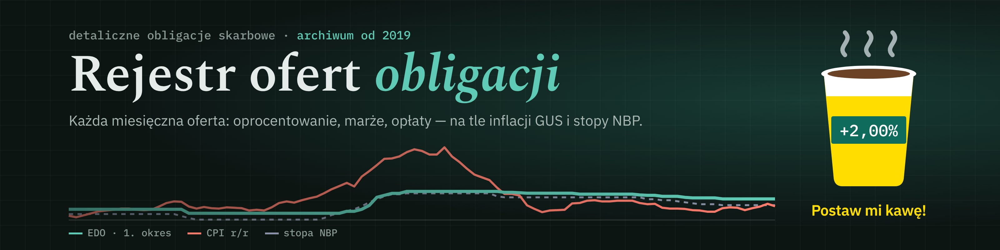

# rejestr-obligacji

<a href="https://www.buymeacoffee.com/patrykw"></a>

<a href="https://www.buymeacoffee.com/patrykw"></a>

[](https://github.com/patrykw-labs/rejestr-obligacji/actions/workflows/validate.yml) [](https://github.com/patrykw-labs/rejestr-obligacji/releases) [](LICENSE)

Archiwum miesięcznych ofert detalicznych obligacji skarbowych od stycznia 2019 r. Dla każdego miesiąca i każdej serii (OTS, ROR, DOR, TOS, COI, EDO, ROS, ROD oraz historycznie DOS i TOZ) zapisane są: oprocentowanie w 1. okresie, marża, zasada oprocentowania, opłata za przedterminowy wykup, cena zamiany i link do listu emisyjnego. Wszystko na tle inflacji (CPI r/r, GUS) i stopy referencyjnej NBP.

**Strona:** https://patrykw-labs.github.io/rejestr-obligacji/

Na stronie jest sześć widoków (w każdym dymki „?” objaśniają pola i kolumny tabel):

- **Oferta miesiąca**: wszystkie serie z wybranego miesiąca, zmiany względem poprzedniego miesiąca, CPI i stopa NBP.
- **Wykres w czasie**: oprocentowanie 1. okresu, marże albo faktyczne oprocentowanie 2. roku (z późniejszych odczytów CPI i stóp NBP) dla wybranych serii na tle CPI i NBP.
- **Historia serii**: jedna seria miesiąc po miesiącu, z różnicą m/m i realnym oprocentowaniem (1. okres − CPI). Przełącznik „Jak wypadła seria” pokazuje, ile dała obligacja za 100 zł z każdej emisji: do wykupu w terminie albo do dziś, po podatku (albo w IKE), rocznie i na tle inflacji w tym samym czasie.
- **Kalkulator zamiany**: czy opłaca się zerwać posiadane obligacje (EDO, COI, TOS, ROS, ROD, DOR, ROR, OTS) i kupić nowe z bieżącej oferty. Wybierasz swoją serię z archiwum (parametry z listu emisyjnego uzupełniają się same, a oprocentowanie do dziś liczone jest z prawdziwych odczytów CPI, a dla ROR i DOR — ze stóp NBP), liczbę sztuk, dzień zakupu, miesiąc i dzień zerwania (także w przeszłości — np. żeby sprawdzić decyzję sprzed lat, z rzeczywistą inflacją albo „stanem wiedzy” z tamtego dnia — lub w przyszłości) (odsetki narosłe od ostatniej rocznicy pokrywają część opłaty), horyzont, scenariusz inflacji (i stopy NBP dla ROR/DOR), oprocentowanie konta i rachunek (zwykły, IKE albo IKZE). Wynik: werdykt, koszt zerwania (opłata i podatek), od kiedy zamiana się opłaca, próg inflacji (a dla ROR/DOR także stopy NBP), przy którym zamiana zaczyna się opłacać, wykres od zakupu (z zaznaczonymi zakupami i wykupami, paskiem różnicy i przybliżeniem prognozy) i tabela rok po roku. Możesz też dodać kilka serii naraz (portfel, do 8 serii): każda jest liczona osobno, a kalkulator wskazuje, które opłaca się zamienić, i sumuje wynik (reszty poniżej 100 zł z zerwanych serii łączy przy zakupie). Obsługuje też obligacje kupione przed 2019 r., które nie zostały jeszcze wykupione (EDO od 12.2016, ROD od 10.2016): parametry z listów emisyjnych i inflacja z GUS są w `data/przed-2019.json`. Wyliczenie można udostępnić linkiem.
- **Co kupić?**: wpisujesz kwotę, okres i założenia (inflacja, stopa NBP, konto, rachunek zwykły / IKE / IKZE), a strona porównuje wszystkie serie z bieżącej oferty: ile każda da na rękę na koniec okresu (po opłacie za wcześniejszy wykup i podatku), nominalnie i realnie, z rankingiem, wykresem i progiem inflacji, przy którym zmienia się zwycięzca. ROS i ROD pokazuje na życzenie (tylko dla beneficjentów 800+).
- **Mój portfel**: wpisujesz serie, które masz (do 20), albo wklejasz tabelę z rachunku („Stan rachunku rejestrowego”: kod serii, liczba sztuk, data wykupu — tekst zostaje w przeglądarce), a strona pokazuje ich wartość dziś (z narosłymi odsetkami), ile dostaniesz na rękę po zerwaniu (opłata i podatek; seria kupiona przed mniej niż 8 dniami albo z wykupem za mniej niż 20 dni — z informacją, że według listu emisyjnego nie da się jej teraz zerwać), ile przy wykupie w terminie, a także najbliższe 12 miesięcy: kupony, nowe oprocentowanie (znane z odczytów GUS/NBP albo prognoza) i wykupy. Portfel zapamiętuje się w przeglądarce (tylko na tym urządzeniu), więc przy następnej wizycie nie trzeba go wpisywać od nowa; można go też zapisać do pliku `.json` i wczytać na innym urządzeniu, a terminy kuponów i wykupów pobrać jako kalendarz `.ics`. Jednym kliknięciem przechodzisz z tymi seriami do kalkulatora zamiany.
- **Założenia zawsze pod ręką**: w kalkulatorze zamiany, „Co kupić?” i „Mój portfel” po przewinięciu pod formularz pod nagłówkiem zostaje pasek z ustawieniami, które zmieniają cały wynik (rachunek zwykły / IKE / IKZE, inflacja, okres, wycena), i ze skrótem wyniku — zmiana od razu przelicza wykres i tabele, a przy wyniku na chwilę widać poprzednią wartość („było …”). Na telefonie pasek to jedna linijka podsumowania z przyciskiem „Zmień”, który otwiera panel z ustawieniami. Rachunek i scenariusz inflacji wybrane w jednej zakładce przechodzą do pozostałych (link z parametrami ma pierwszeństwo). Przy IKE i IKZE widać też, ile ta sama decyzja dałaby na zwykłym rachunku: w „Co kupić?” jako przerywany kontur przy słupkach zysku, w kalkulatorze jako przerywana linia różnicy na wykresie.

Wyniki kalkulatora zamiany i „Co kupić?” można pobrać: wykres jako PNG, tabelę jako CSV (otwiera się w Excelu). Nowe oferty można śledzić w czytniku RSS: kanał Atom [`feed.xml`](https://patrykw-labs.github.io/rejestr-obligacji/feed.xml).

> Projekt jest nieoficjalny. Nie jest powiązany z Ministerstwem Finansów, PKO BP ani serwisem obligacjeskarbowe.pl i nie jest rekomendacją inwestycyjną. Dane pochodzą z publicznych źródeł: listów emisyjnych, [obligacjeskarbowe.pl](https://www.obligacjeskarbowe.pl), komunikatów MF, [GUS](https://stat.gov.pl) i [NBP](https://nbp.pl). Wiążące są listy emisyjne.

## Struktura

- `index.html`: szkielet strony; `css/style.css`: style; `js/app.js`, `js/kalkulator.js`, `js/kupno.js`, `js/portfel.js`: kod widoków; `js/wspolne.js` (dymki, „Wyczyść ustawienia”), `js/eksport.js` (CSV, PNG), `js/start.js` (start strony) (czysty HTML, CSS i JS, bez kroku budowania). `scripts/assets.py --fix` wpisuje do adresów plików skróty ich treści, żeby przeglądarka zawsze pobrała aktualną wersję.
- Wersja strony (pasek górny i stopka) liczona jest w przeglądarce: wydanie z `CHANGELOG.md` i — z API GitHuba (`api.github.com`) — liczba commitów po wydaniu oraz skrót ostatniego commita; wynik zapamiętywany na 15 minut.
- `assets/fonts/`: czcionka Plus Jakarta Sans (woff2, licencja SIL OFL 1.1 w `OFL.txt`) — strona nie korzysta z Google Fonts.
- `feed.xml`: kanał Atom z ofertami z ostatnich 36 miesięcy, generowany z danych przez `scripts/feed.py` (`validate.py` sprawdza, czy jest aktualny).
- Inflacja skumulowana (wynik realny serii, linie „wpłata + inflacja”) liczona jest z poziomu cen GUS: łańcucha wskaźników „grudzień poprzedniego roku = 100” (pole `cpiYtd`).
- `data/months.json`: wszystkie dane, jeden rekord na miesiąc oferty (`"RRRR-MM"`). Schemat jest opisany w [`.claude/CLAUDE.md`](.claude/CLAUDE.md).
- `data/przed-2019.json`: serie sprzed 2019 r. i inflacja z GUS za 2015–2018, tylko dla kalkulatora zamiany
- `scripts/validate.py`: walidacja schematu i statusów weryfikacji
- `js/zamiana.js`: silnik kalkulatora zamiany; `scripts/test_zamiana.js`: jego testy (m.in. zgodność z niezależnym arkuszem kontrolnym i z zasadami z listów emisyjnych); `scripts/test_strona.js`: test strony w przeglądarce (wszystkie zakładki i linki kalkulatora, komputer i telefon). Wszystko uruchamiane w GitHub Actions
- `.github/workflows/validate.yml`: uruchamia walidację po każdej zmianie danych
- `scripts/check_offer.py` i `.github/workflows/check-offer.yml`: 3. dnia miesiąca porównuje rekord bieżącego miesiąca z ofertą, listami emisyjnymi i stopą NBP, a 20. dnia sprawdza też, czy szybki szacunek CPI zastąpiono odczytem finalnym GUS; wartości CPI r/r i zmiany cen od grudnia (rekord miesiąca i całe archiwum) porównuje z tablicą GUS (`scripts/test_check_offer.py` — test bez sieci); przy rozbieżności przebieg kończy się błędem
- `assets/`: grafiki (baner)
- `CHANGELOG.md`: historia zmian (sekcje są też notatkami do wydań na GitHubie)
- `.claude/CLAUDE.md`: instrukcje dla Claude Code, w tym procedura dopisywania miesiąca

## Aktualizacja co miesiąc

Dane aktualizują się automatycznie:

- **1. dnia miesiąca** (z drugą próbą 2. dnia) zadanie w chmurze (Claude Code) dopisuje rekord nowej oferty, gdy zaczyna się jej sprzedaż: każdą serię sprawdza w liście emisyjnym, dodaje stopę referencyjną NBP z 1. dnia miesiąca i szybki szacunek CPI z GUS, a w poprzednim rekordzie zamienia szybki szacunek na odczyt finalny. Po walidacji (`scripts/validate.py`) robi commit `oferta RRRR-MM`.
- **17. dnia miesiąca** to samo zadanie zamienia szybki szacunek CPI w bieżącym rekordzie na odczyt finalny GUS (commit `CPI RRRR-MM finalny`).
- **3. i 20. dnia miesiąca** GitHub Actions (`scripts/check_offer.py`) porównuje rekord bieżącego miesiąca z ofertą, listami emisyjnymi i archiwum stóp NBP, a od 18. dnia sprawdza, czy CPI jest już finalne; wartości CPI w całym archiwum porównuje z tablicą GUS. Przy rozbieżności przebieg kończy się błędem.

Ręcznie (np. gdy zadanie się nie powiodło): w folderze repozytorium napisz Claude Code „dopisz nowy miesiąc” albo „podmień CPI na finalny”. Procedury są opisane w [`.claude/CLAUDE.md`](.claude/CLAUDE.md).

## Podgląd lokalny

Strona wczytuje JSON przez `fetch`, więc otwórz ją przez serwer, a nie bezpośrednio z dysku:

```
python3 -m http.server
```

i wejdź na http://localhost:8000.

## Publikacja

Strona jest budowana przez GitHub Pages: Settings → Pages → Deploy from a branch → `main` / `(root)`. Każdy push na `main` automatycznie odświeża stronę w ciągu 1–2 minut. Plik `.nojekyll` wyłącza przetwarzanie przez Jekyll, więc pliki są serwowane bez zmian.

## Statystyki

Anonimowe statystyki odwiedzin (bez cookies): [rejestr-obligacji.goatcounter.com](https://rejestr-obligacji.goatcounter.com/). Kliknięcia w przyciski Buy Me a Coffee są liczone jako zdarzenia `buymeacoffee`, `buymeacoffee-banner` i `buymeacoffee-footer`.

## Błędy w danych

Jeśli jakaś liczba nie zgadza się z listem emisyjnym, [załóż zgłoszenie](https://github.com/patrykw-labs/rejestr-obligacji/issues). Podaj miesiąc, serię i link do listu.

## Wsparcie

Jeśli rejestr Ci się przydaje: [☕ Postaw mi kawę](https://buymeacoffee.com/patrykw).

## Licencja

Kod: [GNU Affero General Public License v3.0](LICENSE) (`AGPL-3.0-only`), © 2026 patrykw-labs. Możesz go używać, zmieniać i rozpowszechniać, także komercyjnie, ale zmieniona wersja musi być udostępniona na tej samej licencji razem z kodem źródłowym — również wtedy, gdy udostępniasz ją innym tylko przez sieć (np. jako stronę albo usługę). Program jest dostarczany bez jakiejkolwiek gwarancji (szczegóły w [LICENSE](LICENSE)).

Wydania do v1.5.3 włącznie zostały opublikowane na licencji MIT i na jej warunkach można dalej korzystać z tamtych wersji; licencja AGPL-3.0 obowiązuje od kolejnej wersji.

Dane w `data/` to fakty z publicznych źródeł (MF, GUS, NBP) — licencja dotyczy kodu, a nie tych źródeł. Czcionka w `assets/fonts/` ma własną licencję (SIL OFL 1.1, `OFL.txt`).
